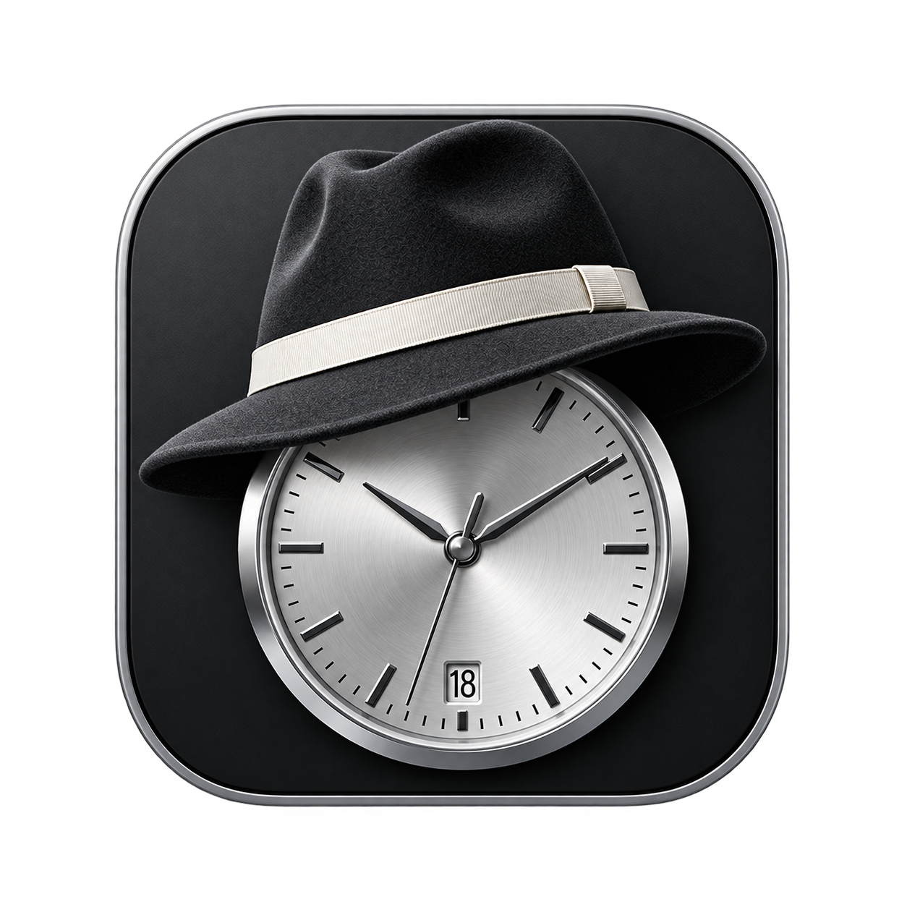

# Recall

### Never miss a moment with continuous retrospective screen capture on macOS.

Recall is a lightweight macOS menu bar application that records your display continuously in the background using native Apple hardware acceleration. When an unexpected bug, highlight, or memorable moment occurs, simply drag downward from the menu bar icon to retroactively export high-quality video clips in seconds.

<p align="center">
  
</p>

<p align="center">
  
  
  
  
  
  
  
</p>

---

## Why Recall?

Traditional screen recording forces you to predict when something important is going to happen. If you forget to hit record, fleeting bugs, unrepeatable software behavior, or unexpected presentation moments are lost forever. Conversely, keeping heavy screen recording tools running constantly drains system resources and clutters your storage.

**Recall solves this by turning screen capture into an effortless retrospective safety net.**

* **Silent & Weightless:** Runs continuously in the menu bar with zero-copy GPU frame handling, using minimal system resources.
* **Instant Time Retrieval:** Drag downward from the menu bar at any moment to select and export what just happened.
* **Controlled Disk Footprint:** Automatically manages storage with an automated rolling ring-buffer so disk space never overflows.
* **Private by Default:** Recordings stay in a folder only you can read, out of Time Machine and Spotlight, and recording pauses whenever the screen is locked.

---

## Key Capabilities

### Continuous Background Buffer
Captures the main display at 30 FPS with `ScreenCaptureKit` and hardware-accelerated H.264 (or HEVC) encoding into rolling 10-second chunks. If ScreenCaptureKit fails to start or delivers no frames, Recall falls back to `CGDisplayStream` automatically and remembers that choice until the next macOS update.

### Drag-to-Export Glassmorphism HUD
An interactive translucent beam (`OverlayHUDWindow`) appears when dragging down from the menu bar icon. Steps are fine-grained for recent history (10 s, 20 s, 30 s, 45 s, 1 min…) and coarser further back; the end of the drag selects everything recorded. The clip ends at the moment you started dragging, and the HUD itself is never part of the recording.

### Zero-Copy Frame Pipeline
Frames arrive as IOSurface-backed pixel buffers and go straight to the hardware encoder, with no CPU copies.

### Recording Status at a Glance
The menu bar icon dims with a pause badge while recording is paused, and with a slash when Recall is not recording (for example when Screen Recording permission is missing). Hover the icon or open its menu to see why.

### Automated Retention Management
`ChunkManager` keeps an index of stored chunks and purges the oldest ones whenever the size (MB) or time (minutes) limit is reached. Lowering a limit below what is already recorded asks before deleting anything.

### Lossless, Near-Instant Export
Clips are joined and trimmed with AVFoundation stream copy: no re-encoding, no quality loss, no external tools. Recall re-encodes only when chunks cannot be joined as they are (for example after a resolution change mid-clip).

### Crash-Safe Recording
Chunks are written as fragmented MP4 files, so an unexpected quit or power loss costs at most about a second. Quitting normally (including `kill`, logout and shutdown) saves the chunk in progress first.

### TCC Permission Preservation
Incremental build automation (`build.sh`) checks binary timestamps before signing, avoiding redundant re-signing and keeping macOS Screen Recording permissions valid between developer builds.

---

## Product Experience

1. **Always-On Background Capture:** Recall launches quietly into your menu bar and maintains a continuous rolling history of your display activity.
2. **Drag to Select History:** Click and drag downward from the Recall menu bar icon. The translucent glassmorphism HUD beam tracks your gesture and previews where the clip starts (e.g. `14:27:30 (-2m 30s)`).
3. **Release to Export:** Release the mouse button. Recall immediately joins the relevant recording chunks and exports an `.mp4` file to your designated folder.
4. **Instant File Reveal:** The exported video file is highlighted in Finder, and a notification confirms the export (or explains why it failed).

Right-click the icon to pause or resume recording, open Settings, or quit.

---

## What Makes It Different

* **Gesture-Driven Retrospective Export:** Instead of opening complex timeline editors, a quick downward drag from your status bar triggers clip generation.
* **Hardware-Native Architecture:** Built on low-level macOS frameworks (`ScreenCaptureKit`, `IOSurface`, `AVFoundation`) for minimal impact on system performance.
* **Smart Binary Timestamp Incremental Builds:** Resolves the common macOS developer friction point where re-compiling invalidates Screen Recording privacy permissions in System Settings.

---

## Primary Use Cases

* **Bug Capture & Software QA:** Instantly extract video proof of hard-to-reproduce software bugs right after they occur.
* **Meetings & Live Demos:** Save key segments from live presentations or virtual code reviews without recording hours of idle screen time.
* **Content & Game Highlights:** Capture spontaneous moments or gameplay achievements retroactively.

---

## Quick Start

### Download Pre-built Release

Download the latest styled `.dmg` installer disk image directly from [GitHub Releases](https://github.com/unamatasanatarai/recall/releases/latest), open the volume, and drag `Recall.app` to your Applications folder. The app is a universal binary and runs natively on Apple silicon and Intel Macs.

### Prerequisites (For Building From Source)

* macOS 12.3 or later
* Xcode Command Line Tools (`swiftc`, `codesign`)

### Building & Running

Clone the repository and compile Recall using `make`:

```bash
git clone https://github.com/unamatasanatarai/recall.git
cd recall
make build
make run
```

To launch a compiled build without recompiling (preserving macOS Screen Recording TCC permissions):

```bash
make launch
```

`make build` also refreshes `/Applications/Recall.app` when it is installed and writable.

---

## Developer Workflows

### Running Unit Tests & Coverage

Execute the automated Swift test suite (tests are discovered automatically; every test runs against a throwaway cache directory, never your real recordings):

```bash
make test
```

Run a single test or group by name:

```bash
./scripts/test.sh ChunkWriter
```

Run the suite under ThreadSanitizer:

```bash
make test-tsan
```

Generate a code coverage summary:

```bash
make coverage
```

### Packaging Installer DMG

Create a styled `.dmg` installer volume with custom background graphics:

```bash
make dmg
```

Output: `build/Recall-v<VERSION>.dmg`.

### Automated Release Workflow

Run tests, bump the version, extract git commit changelogs, build a fresh DMG, tag git, and publish a GitHub release:

```bash
# Preview release notes and build DMG without committing, tagging, or publishing
make release-dry-run

# Auto-bump patch version and publish release
make release

# Specify explicit release version
make release VERSION=1.1.0
```

A release refuses to run from a dirty working tree, from a branch other than `master`, or for a tag that already exists. Tests run before `VERSION` is changed, `VERSION` is restored if a later step fails, and nothing is published unless the push succeeds.

### Resetting TCC Permissions

Reset all macOS privacy permissions (Screen Capture, Accessibility, Microphone, Camera, and full system permissions) during testing:

```bash
make revoke
```

---

## Configuration

Settings can be customized via the Preferences window (`Cmd + ,` or right-click menu bar icon):

* **Closing / Quitting from Preferences:** Double `Cmd + Q` (`⌘Q`) allows closing and quitting the application with an in-window prompt notification to confirm before exit. Single `Esc` or `Cmd + W` closes the Preferences window.
* **Export Location:** Output directory for exported clips. *(Default: `~/Movies/Recall-exports`)*
* **Max Size (MB):** Maximum disk buffer capacity for stored video chunks. *(Default: `1000 MB`, range 50–100,000)*
* **Max Time (Minutes):** Maximum historical time window retained. *(Default: `60 Minutes`, range 5–10,080)*
* **Launch Recall at login:** Opens Recall when you log in.
* **Record at native Retina resolution:** Records at the display's full pixel resolution for sharper text, at the cost of larger files. *(Default: off, records at point resolution)*
* **Use HEVC encoding:** About 40% smaller files, so roughly twice the history fits in the same Max Size. Available on Macs with a hardware HEVC encoder.

Recall records the main display only. Recording pauses automatically while the screen is locked, the screensaver runs, the display sleeps, or the Mac sleeps.

### Storage & Logging

* **Recording Chunks:** `~/Library/Caches/com.recall.app/chunks.noindex/` *(readable only by you; excluded from Time Machine and Spotlight)*. Chunks recorded by earlier versions in `~/.cache/recall` are moved here on first launch.
* **Logs:** Recall uses macOS unified logging. Follow them live with:

  ```bash
  log stream --predicate 'subsystem == "com.recall.app"'
  ```

---

## License

Licensed under the [GNU General Public License v2.0](LICENSE).
